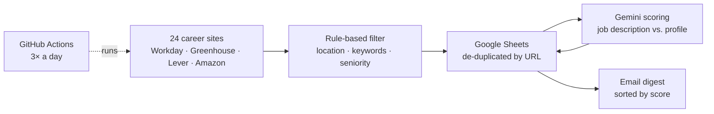

# Job Search Agent 🤖

An automated agent that finds relevant junior roles in Israel, scores each one against my CV with an LLM, and emails me a digest three times a day — fully hands-off, running in the cloud for free.

## What it does

1. **Collects** open positions from 24 company career sites (NVIDIA, Intel, Salesforce, Applied Materials, Amazon, Wiz, Payoneer, JFrog, Taboola, Riskified and more) through their public job APIs.
2. **Filters** them with cheap rules first: location in central Israel, relevant title keywords, and exclusion lists for senior or off-field roles.
3. **Stores** new jobs in Google Sheets, de-duplicated by URL, so every job is processed only once.
4. **Scores** each new job 1–10 with Google Gemini, comparing the full job description to my candidate profile, and writes a one-line reason.
5. **Emails** a digest after every run, sorted by score with strong matches highlighted, or a short "no new jobs" note.
6. **Runs automatically** at 09:00, 13:00 and 17:00 Israel time with GitHub Actions.



## Tech stack

| Area | Tools |
|---|---|
| Language | Python (`requests`, `gspread`) |
| Data sources | Workday, Greenhouse and Lever job APIs; amazon.jobs |
| Storage | Google Sheets API (service account) |
| AI | Google Gemini API (free tier) |
| Notifications | Gmail SMTP |
| Scheduling | GitHub Actions (cron) |
| Cost | $0 — everything runs on free tiers |

## Design decisions

- **Public APIs, not scraping.** I pulled jobs from the official JSON endpoints that career sites use instead of scraping LinkedIn or job boards. This approach is more reliable, and it respects the sites' terms of use.
- **Cheap filter before expensive AI.** Rule-based filters remove irrelevant roles before any LLM call. This keeps the agent inside Gemini's free-tier limits and makes each run faster.
- **Batching and retries.** Jobs are scored in small batches, with automatic retries when the API is busy (HTTP 429/503) or slow. The first version used a heavier model that timed out, so I switched to a lighter model. Scoring jobs doesn't need the largest model.
- **Idempotent runs.** Jobs are de-duplicated by URL, and only unscored rows go to the LLM. A failed run can simply be re-run without creating duplicates or wasting quota.
- **Source discovery tool.** Every company uses a different hiring system and ID. So instead of guessing, `discover_sources.py` tests candidate companies against each system and reports which ones work and how many Israeli jobs they have.
- **Data quality checks.** The first run returned 1 relevant job out of 200. Investigating showed that jobs listed in several cities appear as "2 Locations" and were being dropped, and that the job list was being cut off at 200. Fixing both raised the count to 21. Later, "remote" was matching remote jobs worldwide, so I removed it from the location list.
- **Secrets stay out of the code.** API keys, the Google service-account key and my profile live in `.env` locally and in GitHub Secrets in the cloud. None of them are committed.
- **Time-zone safe scheduling.** GitHub cron runs on UTC. The workflow triggers at both the winter and summer UTC times and then checks the Israel hour, so daylight-saving changes never shift the schedule.

## Project structure

```
fetch_jobs.py        # main entry: collect → filter → save → score → email
sheets.py            # Google Sheets read/write and de-duplication
scorer.py            # Gemini scoring with batching and retries
notifier.py          # HTML email digest
discover_sources.py  # finds which companies expose a usable job API
.github/workflows/   # GitHub Actions schedule
```

## Running it yourself

1. `pip install -r requirements.txt`
2. Create a Google Cloud service account with the Sheets and Drive APIs enabled, save its key as `credentials.json`, and share your sheet with the service account's email.
3. Write your candidate profile in `profile.txt`.
4. Create a `.env` file:
   ```
   GEMINI_API_KEY=...
   EMAIL_ADDRESS=you@gmail.com
   EMAIL_APP_PASSWORD=...   # a Gmail App Password
   ```
5. Put your sheet's ID (from its URL) in `SHEET_ID` in `sheets.py`.
6. `python fetch_jobs.py`

To run it on a schedule, add the same values as GitHub repository secrets (`GEMINI_API_KEY`, `EMAIL_ADDRESS`, `EMAIL_APP_PASSWORD`, `GOOGLE_CREDENTIALS`, `PROFILE`).

---
Built by Tamar Yaffe.
